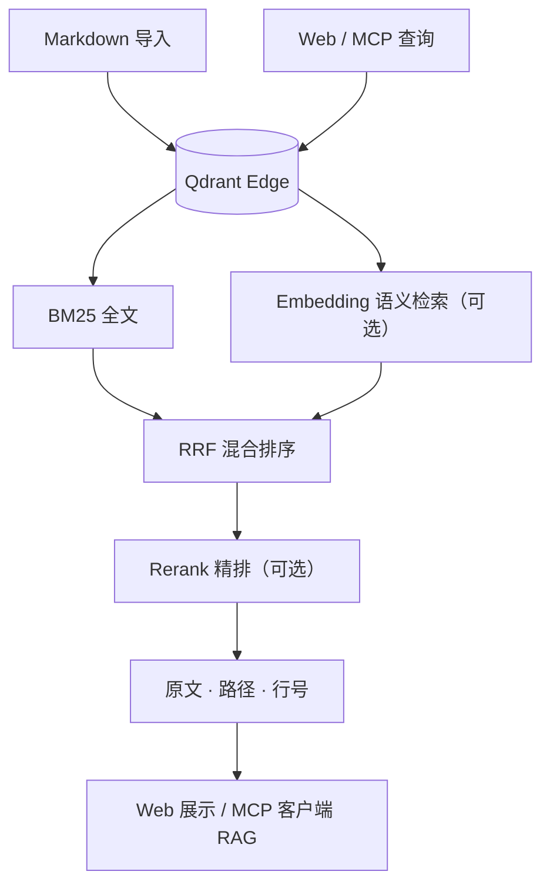

# Rust Knowledge Server

在网页创建知识库、批量导入 Markdown，并搜索已发布的文档。Claude Code、OMP 等客户端也可通过 MCP 查询同一份资料，取得原文片段、文件路径和行号。



## 启动（Windows x64）

在可执行文件所在目录打开 PowerShell：

```powershell
.\rust-knowledge-server.exe
```

数据保存在 `~/.rust-knowledge-server`，机器重启后保留。

## 启动（CentOS 7 x64）

从 [GitHub Releases](https://github.com/jchanghong023/rust-knowledge-server/releases) 下载 `rust-knowledge-server-centos7-x86_64.tar.gz` 并解压。

```sh
./rust-knowledge-server
```

后台运行：

```sh
./rust-knowledge-server start
./rust-knowledge-server status
./rust-knowledge-server stop
```

`start` 可接 `--listen` 等启动参数。日志：`/dev/shm/rust-knowledge-server/daemon.log`。后台模式不自动重启。

无需 root。所有数据保存在 `/dev/shm/rust-knowledge-server`。重启进程可复用；机器重启后清空，请自行保存 Markdown 并重新导入。

[构建脚本](release/build-centos7.sh) · `./rust-knowledge-server --help`

推送 `v<主版本>.<次版本>.<修订号>` 标签会触发 GitHub Actions，只构建并发布 CentOS 7 x64 压缩包。手动运行 `Release CentOS 7` 工作流只构建并上传 Actions 产物，不创建 Release。

## Web

前台启动后，打开控制台 `Web:` 行显示的地址（默认 `http://127.0.0.1:9333/`）。从其他机器访问时，使用服务 IP 和实际监听端口。服务不验证身份；请用防火墙限制访问，只在获准共享工号和活动记录的范围内开放。

Web 兼容 CentOS 7.9 x64 原始发行包中的 Firefox ESR 68.10.0；使用默认浏览器设置即可通过内网 HTTP 直连，无需升级或安装扩展。

输入 8 位数字工号（仅留痕）→ 建库 → 上传 UTF-8 Markdown 文件或文件夹 → 导入成功后搜索。

网页显示文件上传百分比；服务接收后，在「导入状态」查看已处理的文件数、已写入的文段数，以及索引保存和发布阶段。服务接收后刷新同一标签页，仍可继续查看进度。

在已发布的知识库下展开「导入路径」，可查看当前版本的全部 Markdown 相对路径（包括空文件）。旧版本可恢复已索引文件的路径；如需补全空文件路径，请重新导入。

「活动记录」是独立页面，可直接打开 `/#activity`，无需登记。清册显示最近 30 天的登记工号和时间；展开工号即可查看仍保留的知识库操作及结果。「刷新记录」会更新名单和已展开的历史，不会折叠工号。

**重导会整库替换**，请上传要保留的全部文件。

## MCP 工具

`/mcp` 提供两个只读工具，无需 Web 工号登记：

| 工具 | 参数 | 返回 |
| --- | --- | --- |
| `knowledge_search` | `query` 必填；`library`、`path` 可选，用于限定库和库内相对路径 | 最多 5 条原文摘录，原文合计不超过 4 KiB；每条附库名、路径、行号和 `ref`。 |
| `knowledge_fetch` | `ref` 必填，从一条搜索命中原样传回 | 命中附近的同版本连续原文，最多 60 行且不超过 4 KiB。 |

两者的字节预算都只计算 UTF-8 原文；`truncated` 表示摘录已截短，行号对应实际返回的内容。若知识库被重导或删除，旧 `ref` 返回 `stale_ref`，请重新搜索；服务进程重启不影响仍已发布版本的引用。

## Claude Code

在项目目录运行：

```sh
claude mcp add --transport http knowledge http://127.0.0.1:9333/mcp
```

在 Claude Code 中用 `/mcp` 检查连接，即可提问。

## OMP

**配套 OMP 已内置，0 配置。** 服务启动后直接提问：

> 查知识库里的 `std::vector` 用法，附原文和行号。

[技术方案](openspec/changes/add-standalone-knowledge-server/design.md) · [部署验收](openspec/changes/add-standalone-knowledge-server/tasks.md)
