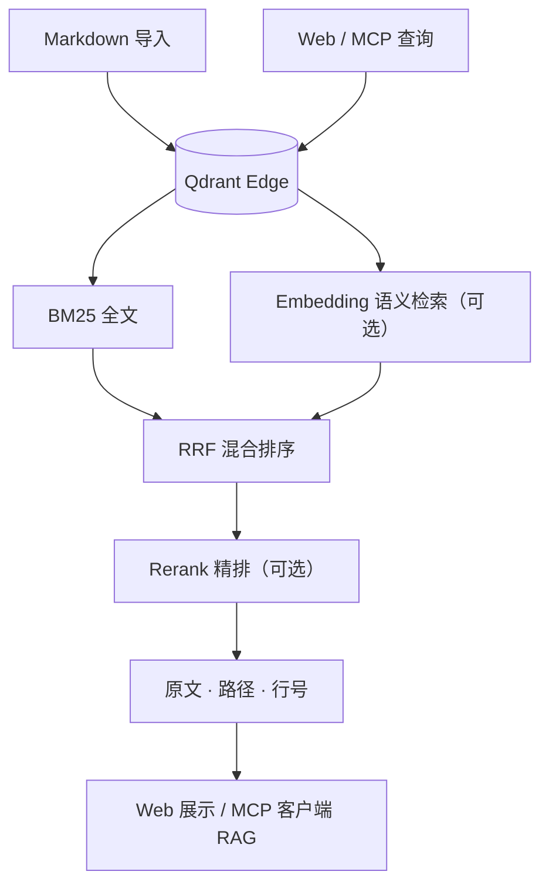

# Rust Knowledge Server

在网页创建知识库、批量导入 Markdown，并搜索已发布的文档。Claude Code、OMP 等客户端也可通过 MCP 查询同一份资料，取得原文片段、文件路径和行号。



## 启动（Windows x64）

在可执行文件所在目录打开 PowerShell：

```powershell
.\rust-knowledge-server.exe
```

数据保存在 `~/.rust-knowledge-server`，机器重启后保留。

## 启动（CentOS 7 x64）

```sh
./rust-knowledge-server
```

后台运行：

```sh
./rust-knowledge-server start
./rust-knowledge-server status
./rust-knowledge-server stop
```

`start` 可接 `--listen` 等启动参数。日志：`/dev/shm/rust-knowledge-server/daemon.log`。后台模式不自动重启。

无需 root。所有数据保存在 `/dev/shm/rust-knowledge-server`。重启进程可复用；机器重启后清空，请自行保存 Markdown 并重新导入。

[构建脚本](release/build-centos7.sh) · `./rust-knowledge-server --help`

## Web

打开 `http://<服务IP>:9333`。服务不验证身份；请用防火墙限制访问，只在获准共享工号和活动记录的范围内开放。

输入 8 位数字工号（仅留痕）→ 建库 → 上传 UTF-8 Markdown 文件或文件夹 → 导入成功后搜索。

「活动记录」是独立页面，可直接打开 `/#activity`，无需登记。清册显示最近 30 天的登记工号和时间；展开工号即可查看仍保留的知识库操作及结果。「刷新记录」会更新名单和已展开的历史，不会折叠工号。

**重导会整库替换**，请上传要保留的全部文件。

## Claude Code

在项目目录运行：

```sh
claude mcp add --transport http knowledge http://127.0.0.1:9333/mcp
```

在 Claude Code 中用 `/mcp` 检查连接，即可提问。

## OMP

**配套 OMP 已内置，0 配置。** 服务启动后直接提问：

> 查知识库里的 `std::vector` 用法，附原文和行号。

[技术方案](openspec/changes/add-standalone-knowledge-server/design.md) · [部署验收](openspec/changes/add-standalone-knowledge-server/tasks.md)
