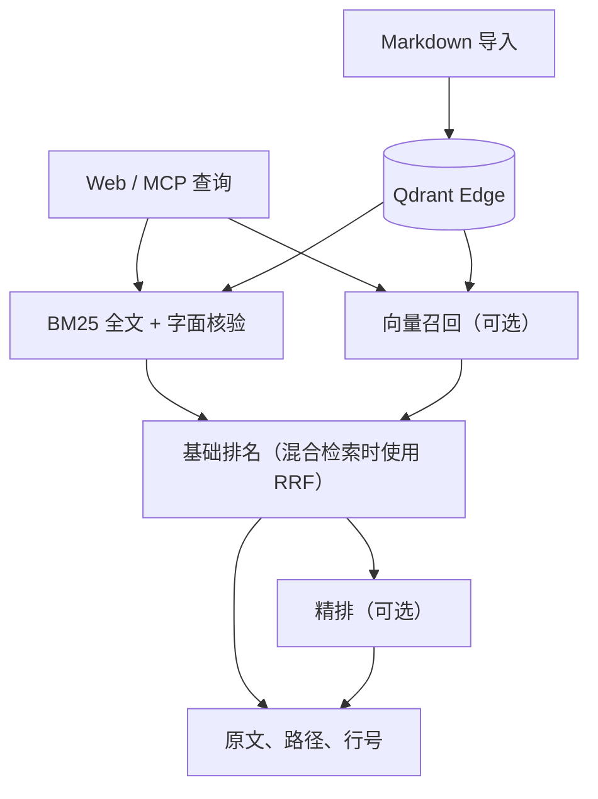

# Design

## Context

独立服务将 Web 管理与 MCP 查询集中在一个 Rust 进程内，支持离线交付。CentOS 7 部署不依赖持久化本地磁盘：服务数据只存于 `/dev/shm`，原始 Markdown 由操作者另行保管。

## 检索数据流

## Goals / Non-Goals

**Goals:** Rust 独立进程内完成索引、查询和按命中补读；浏览器和 MCP 各自负责协议适配。知识库模块集中保证发布、查询和补读的版本一致性，并用真实发布包验证跨平台交付。

**Non-Goals:** 不引入独立数据库进程、数据库端口、外部身份目录或访问权限模型；不承诺固定的全文排名或大语料检索延迟。

## Decisions

1. **链接 Qdrant Edge，而不是把 `qdrant` 服务二进制塞进发行包。** 本地源码 `lib/edge` 提供可发布的 Rust crate `qdrant-edge`，含 `EdgeShard` 创建、重开、写入、查询、flush 和 BM25 稀疏向量支持。锁定可追溯的版本或源码提交；依赖准备在构建期完成，不使用机器专属绝对路径。已读源码证明接口可选，不意味着本服务已在目标机器验证。二进制嵌入 Web 资源，不要求独立前端产物或 sidecar。
2. **以数据根中的库目录表作为唯一发布依据。** 服务持有数据根排他锁，启动只加载库目录表；查询开始时一次性固定所选库的版本句柄，在有界阻塞执行池按需打开分片，同一版本的并发请求共用打开结果。
   - 库名称只用于查找，内部库 ID 不复用。接收整库导入时记录库 ID 和当时的发布版本，在独立目录流式构建；上传路径只做索引元数据，暂存文件使用服务生成的名称。完成写入、停止构建写入并 flush 后生成发布清单，同步必要文件，再在同一数据卷原子提交目录表。创建、删除和发布走同一提交路径；发布须校验库仍存在、ID 和基准版本未变。删除先提交撤销发布，已持有版本的读者可以完成；最后一个读者释放后才回收旧版本。
   - 每个已发布版本用清单记录不可缺失的数据段及必要文件的完整性信息。重开前核验，不能把 `EdgeShard::load` 成功当作完整性证明：上游可在配置仍存在时创建缺失的 `segments/` 和新段。数据根仍在时，启动只按已提交的目录表恢复；回收未发布构建和已退役版本，不清空、修复或替换损坏的已发布版本。保留现有同步与提交顺序，不把内存更新或一次 `rename` 调用当作完成。CentOS 7 的同步写入只保证进程重启可复查，不提供断电持久性。正常停机停止接收新操作，再退出数据库句柄。
   - Qdrant Edge 0.9.0 的动态位图在打开时按构建档位调整文件容量，debug 与 release 的最小值分别为 128 字节和 1 MiB。旧清单保持原样；重开时只对合法档位容量差异核对原容量的 SHA-256 与零填充，位图状态和其他必要文件仍按原清单校验。
3. **一个检索实现，两个入口。** 保留现有 Markdown 分片和 Edge BM25。默认与严格模式共用完整技术名倒排及原文字面核验，无可用索引键时均分批核验范围内的原文片段。字面结果中有正文的小节标题优先，目录、索引和单纯的同名提及不抢占规则正文。混合查询优先展示目标标准及其术语共现的证据。已发布索引不需重导。
   - 使用 Edge 稀疏 BM25。先确定发布版本、库和路径范围；在各召回分支设置同一候选过滤条件，在稀疏查询中另设同一范围的 IDF 语料过滤。文档长度归一化使用固定基准，不从全库文档动态取均值。锁定版本须确认支持所需的范围统计，不把「先过滤候选」误当成「范围内排序」。
   - 仅请求解析后的 Embedding 地址；按模型、维度、编码和语料版本判断语义召回资格。向量缺失或不兼容只禁用相应语义分支；查询向量不可用时保留关键词。按分支名次合并，以来源身份去重，保留不同来源，按稳定的证据字段打破并列；按实际方式标记结果，不用向量相似度替代完整名称判定。
   - 单次导入跨文件按最多 128 个片段一轮准备向量，每个请求最多 16 个片段、合计 32,768 个 UTF-16 码元，最多 8 个请求并行；两个导入任务的并发配额各自独立。每个请求单次超时 90 秒；连接或传输失败、超时、HTTP 408／429／5xx 最多尝试 10 次，间隔 10 秒。其他 HTTP 错误和无效响应不重试。失败时继续构建和发布完整关键词索引，不启用不完整的向量代际；查询和精排不使用导入重试策略。
   - 使用同一套 HTTP 客户端调用 `/v1/embeddings` 和 `/v1/rerank`，两者显式配置独立，不猜测服务地址或回退公网。先确定本次全文或混合基础结果，再从中取有限窗口提交 `model`、`query`、`documents`；将 `results` 的 `index` 和 `relevance_score` 对应回原候选，不能从窗口外增删证据。接受省略 `model` 的兼容响应，若显式返回则须与请求一致。完整校验响应后才应用稳定排序；失败原样保留基础排名，日志仅记录脱敏原因。
   - **仅对未显式配置的模型采用默认值。** CentOS 7 前台和后台共用启动配置解析；只有服务启动进程继承 `OMP_OFFLINE=1` 且需要默认模型时，才只读加载启动账号已有的 Claude Code `settings.json`，支持 `CLAUDE_CONFIG_DIR`。复用 `env.ANTHROPIC_BASE_URL` 和 `env.ANTHROPIC_AUTH_TOKEN`，保留路径前缀并避免重复追加 `/v1`。按模型独立采用显式配置或默认值（`Qwen3-Embedding-8B`，4096 维；`Qwen3-Reranker-8B`），不合并两种来源的字段。复用的 Token 仅发给配置的网关，不进入子进程启动参数、日志或持久化存储；不主动探测，配置有误时记录脱敏告警，未获得默认值的能力关闭，全文继续可用。仅在获准将查询和文档片段发送至该网关的部署启用模型自动配置。
4. **浏览器登记不是认证，审计状态以数据根中的记录为准。** 服务校验 `^[0-9]{8}$`，工号只取服务端会话且不接受请求覆盖；HTTP 会话 Cookie 使用 `HttpOnly`、`SameSite=Strict`。Web API 先校验其连接端点对应的 Host；登记和其他 POST/DELETE 请求有 Origin 时，必须验证单个合法 HTTP Origin 与 Host 一致。Firefox ESR 68 可能不附带 Origin，因此仅在该头完全缺失时，解析单个合法的绝对 HTTP Referer URL 并只比较其源；不能覆盖非法、重复或不匹配的 Origin。不信任转发头或根据 User-Agent 放行，不记录原始 Referer。登记成功记录写入后才发会话。浏览器操作以操作 ID 关联开始、结果和提交；开始记录写入后才执行，导入沿用提交时的工号。
   - 创建、删除、发布在目录表的同一原子提交中记录对应操作的结果凭据，结果写入独立审计日志后才可移除凭据。追加失败或数据根保留的进程重启后，按操作 ID 幂等恢复；已提交操作状态读取提交凭据，不报告失败或要求重试。没有提交的导入恢复为中断；确实无法判断的记录标为结果未知。搜索先记录结果再返回证据。日志不保存原文、搜索词或凭据。
   - 「活动记录」复用现有审计数据：以成功登记事件汇总最近 30 天的工号名单，按操作 ID 合并操作开始与结果，沿用现有结果判定规则。浏览器在登记前也能打开活动记录，读取请求不检查会话或角色，仍经过现有 Web Host 校验。只返回工号、时间、操作、目标库和状态，不返回原始日志，不新增审计存储、改变记录保留规则或开放 MCP 查询。
5. **按连接端点校验 Host，无需配置主机名单。** Web 和 MCP 只接受与本次连接的服务端 IP、端口相符的 Host；回环连接也接受同端口的 `localhost`。默认绑定 `0.0.0.0:9333`，本机和其他可达机器均可通过相应 IP 访问；仅本机使用时显式绑定回环地址。部署侧仍需限制可达范围，不以 Host／Origin 校验替代网络限制。MCP 使用锁定的 Rust MCP SDK；发送 `Origin` 的客户端仍须匹配独立的 MCP Origin 白名单。
6. **不引入独立服务配置文件，服务数据根按平台固定。** CentOS 7 使用 `/dev/shm/rust-knowledge-server`；无须 root，在可写的 `/dev/shm` 下以启动用户独占的权限创建目录。现有目录必须归启动用户所有且不允许其他用户读取或写入；拒绝符号链接重定向、非 tmpfs、嵌套挂载或占用中的数据根，不回退。Windows 使用当前用户的 `~/.rust-knowledge-server`，保留本地持久化块存储校验。两个平台都不读取数据根覆盖环境变量、不提供路径参数；索引、目录表、上传暂存、审计、锁及其他服务文件都在固定根内，不访问旧根、不写 NFS、不备份或自动重建。`--help` 说明固定路径和 CentOS 7 重启机器后须手动重导。
7. **CentOS 7 后台管理复用前台服务。** `start` 以新会话运行同一可执行文件，关闭终端输入并把后台诊断写入数据根内的 `daemon.log`；父进程通过独立的启动通道等待数据根初始化、HTTP 绑定和本地控制接口就绪，失败不报成功也不遗留后台实例。只在持有原有数据根排他锁时创建或清理私有 Unix socket；`status` 与 `stop` 通过该 socket 操作，不以 PID 文件判定身份，也不占用另一个网络端口。`stop` 复用正常停机流程，等待停止接收请求并完成在途操作，再确认停机。后台模式不负责进程监管；管理员的会话清理策略仍可终止后台实例。
8. **MCP 搜索返回可引用证据，补读复用已发布索引。** 适配层在共享排序后剔除同文件中重叠的证据，把完全相同的正文或长共同开头合为一个名额，并为各出处保留自己的原文坐标和引用。条数、字节和行数有界，不改变保留项的相对顺序；Web 保留独立的来源结果。成功结果用同一类型生成 schema、结构化结果和兼容文本。
   - MCP 的搜索游标绑定查询和固定的发布版本。翻页继续遍历字面候选，而非只在首页的候选窗口切片；关键词及语义相关结果仍使用原召回预算。页内限制条数、行数和总字节；去重只在页内。命中行来自核验的原文范围，小节标题仅从可核实的 Markdown 上下文提取。
   - `ref` 绑定库 ID、发布版本和所展示的原文字节区间，不用作授权；首次补读保留完整区间，可用同版本的前后页引用继续读取相邻字节。仍已发布的旧引用继续可用。补读开始后发生重导，在途请求可从已固定版本完成；退役版本不延寿，也不以同名新版本替代。
   - 在有界阻塞执行池内按命中点读取同一文件所需的相邻索引片段。现有载荷保留原文字节和源字节偏移，导入按文件内顺序写入片段；按实际边界拼接并消除长行窗口的重叠，不跨文件、不扫描整个库、不重建整篇文档。发现缺口、数据缺失或不一致时报告存储错误，不返回拼凑内容。已有发布索引复用同一路径，无须重导、复制整份语料或读取上传者的文件系统；原文档 SHA-256 继续用于来源核验及 Web，不透出到 MCP。
9. **同一套内嵌网页以 CentOS 7.9 原始发行包的 Firefox ESR 68.10.0 为最低兼容基线。** 采用该浏览器默认支持的原生 HTML、CSS 和 JavaScript，不引入框架、转译、第三方 polyfill 或 CDN。用普通条件判断替代 `?.`、`??`，用标准 HTML 控件提供键盘可操作的明确确认和取消，不依赖 `dialog.showModal()`。用基本 CSS 保持布局和可见焦点，不要求 `clamp()`、`inset` 或 `:focus-visible` 等该版本未默认支持的特性。保留文件及目录选择、相对路径、上传进度与现有页面行为。基线以 [CentOS 7.9 原始发行仓库](https://vault.centos.org/7.9.2009/os/x86_64/Packages/) 为准，不以更新仓库中的 Firefox 版本替代。

## Risks / Trade-offs

- **单文件与目标平台依赖** → 只支持 Windows x64 和 CentOS 7 x64（glibc 2.17）。在 Windows 开发阶段确定最低支持版本，先验证单文件离线启动、Edge 写入、退出、重开和范围 IDF，再推进完整实现；不在 CentOS 7 上跑开发测试。已知 Edge 0.9.0 的 Linux I/O 后端引用 glibc 2.17 未提供的 `pwritev2`，CentOS 7 构建须采用保留范围 IDF 能力且不引用此符号的可追溯 Edge 版本或源码提交，不能依赖额外运行时。4.1 验收 Windows 最终发布文件，并由验收人员在 CentOS 7 目标服务器上手工验证兼容构建、离线启动、数据行为和运行依赖；不以 Windows 结果或较新的 Linux 代替目标服务器验收。
- **tmpfs 容量与数据寿命** → 整库替换时新旧版本和上传暂存并存，CentOS 7 实测 tmpfs 峰值；耗尽时不替换旧版本，不能退到磁盘。进程重启时目录表、索引和审计仍可复用；机器重启清空 `/dev/shm`，服务以空库启动，由操作者用独立保管的 Markdown 重导。Windows 仍验证本地持久化提交。
- **来源保真与检索验证** → 固定合成小样本验证全文、搜索裁剪、补读和来源契约；开发阶段只在回环 HTTP 层替换 `/v1/embeddings`、`/v1/rerank`，其余使用真实客户端、Edge 和排名逻辑，验证模型贡献、降级和默认配置选择，不据此证明真实网关兼容性或效果。4.1、4.2 仍关闭模型，分别保留双平台整批导入、重启和来源验收，以及目标环境的 Web／MCP 全文检索、补读与访问边界验收。4.3 在获准的 CentOS 7 环境以最终发布包验证无模型参数启动、通过实际网关导入并生成向量，以及 Web／MCP 实际混合检索和精排；模型执行状态以 Web 诊断和经批准的脱敏网关证据核对，不要求 MCP 返回诊断字段，不以模型质量指标作为门槛，不替代 4.1、4.2。
- **冒填工号与公开活动记录** → 工号是自报标签，不用于验证身份或权限。Web 活动记录无需登记，网络可达的访客均可查看。部署方必须确认网络访问范围，并取得语料、工号及活动记录在该范围内的共享许可；MCP 不提供活动记录，也不归到任何工号。
